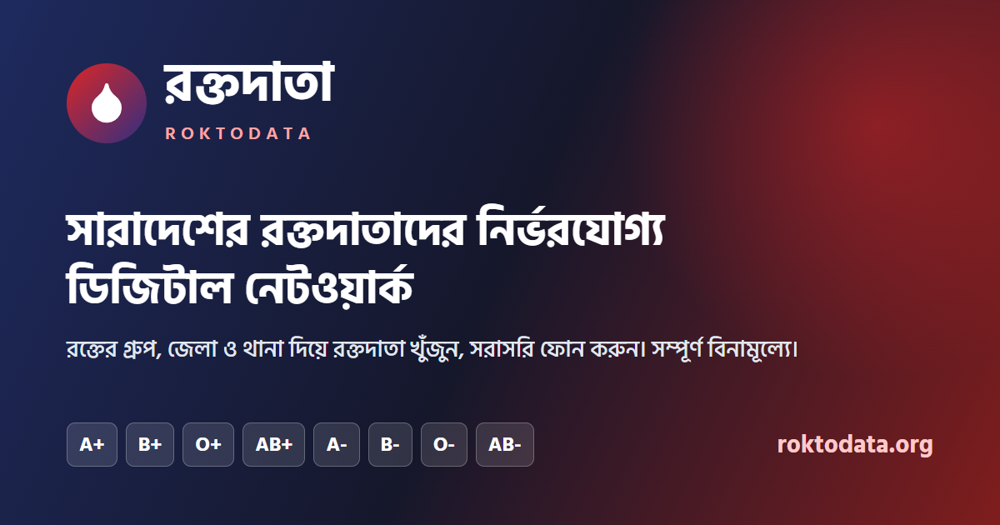
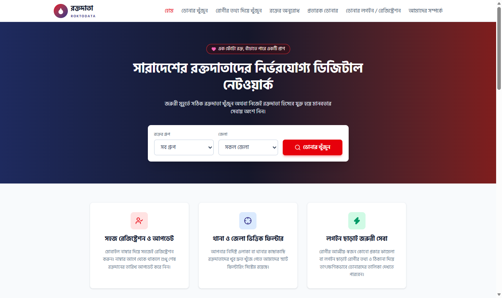
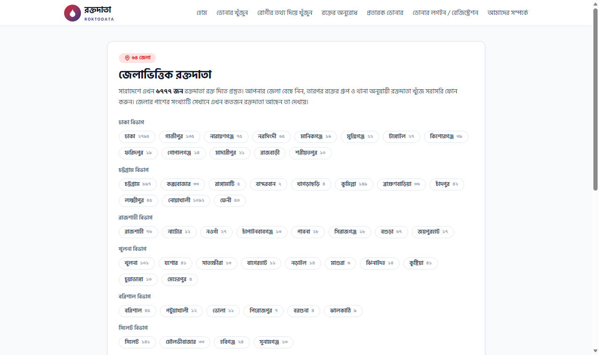
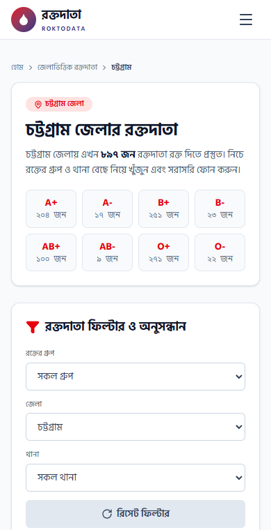
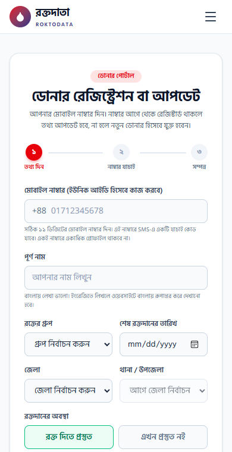
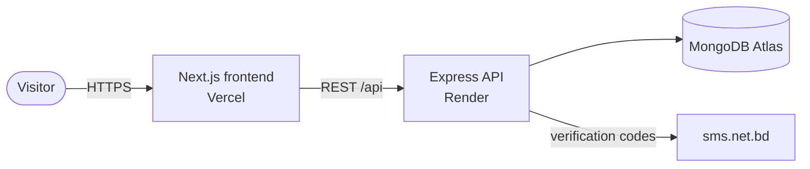

<div align="center">



# রক্তদাতা · Roktodata

**A free, Bangla-first blood donor network for Bangladesh.**<br>
Find a donor by blood group, district and thana, then call them directly. No login, no fees.

**[www.roktodata.org](https://www.roktodata.org)**


</div>

---

## Contents

- [Why](#why)
- [Screenshots](#screenshots)
- [Features](#features)
- [How it works](#how-it-works)
- [Tech stack](#tech-stack)
- [Project structure](#project-structure)
- [Run it locally](#run-it-locally)
- [Environment variables](#environment-variables)
- [Deployment](#deployment)
- [Security and privacy](#security-and-privacy)
- [Credits](#credits)

## Why

When someone needs blood in Bangladesh, the search usually happens in Facebook groups and phone
chains, often with outdated numbers and occasional scams. Roktodata keeps one verified, searchable
list of donors and shows only the people who can actually donate right now: approved, willing,
and at least 90 days past their last donation.

## Screenshots

<table>
  <tr>
    <td colspan="2"></td>
  </tr>
  <tr>
    <td width="50%"></td>
    <td width="50%">
      
      
    </td>
  </tr>
</table>

## Features

**For patients and families**

- **Find donors** by blood group, district and thana. Donors with a name come first, then whoever
  donated longest ago. Each donor card has a one-tap call button.
- **Patient search:** enter the patient's details to get matching donors in the same thana and the
  rest of the district right away. After admin approval, the request appears in the public
  **blood requests** feed (one request per phone number per day).
- **District pages** for all 64 districts (`/donors/<district>`) with live donor counts per blood group.
- **Fraud list:** check a number before sending anyone money, or report a scammer.
- **Complaints:** report a wrong number or misbehaviour from any donor card.

**For donors**

- **Register or update** with a mobile number, confirmed by a 6-digit SMS code.
- Mark yourself **ready / not ready** to donate. You are hidden automatically for 90 days after a donation.
- Names typed in English are **saved and shown in Bangla**, with a preview before saving.

**For admins** (`/admin`)

- Approve new donors and blood requests, block fake profiles (with a public reason), and add
  updates to requests ("রক্ত ম্যানেজ হয়েছে").
- Review complaints and fraud reports, and choose which blocked donors appear in the fraud list.

**Everything else**

- Bangla UI throughout, mobile-first, with Bangla digits.
- Search-engine ready: sitemap, canonical URLs, Open Graph share image, structured data.

## How it works



**Who appears in search.** A donor is listed only when all three hold:

1. an admin has approved the profile (status `Active`);
2. the donor has marked themselves ready to donate;
3. their last donation was 90 or more days ago, or they have never donated.

**Phone verification.** Registering or updating sends a 6-digit code by SMS. The code is valid
for 5 minutes, stored only as an HMAC, works once, and locks after 5 wrong tries. A correct code
returns a 15-minute token that the save request must carry, and the token's number must match the
profile. SMS sending is rate limited per number, per IP and site-wide, so abuse can't drain the
SMS balance.

**Bangla names.** [`utils/banglaName.js`](roktodata-backend/utils/banglaName.js) converts English
input using a dictionary of about 1,260 Bangladeshi name words, then falls back to phonetic spelling.
For example, "Md. Sabbir Hossain" becomes "মোঃ সাব্বির হোসেন".

**One profile per number.** The phone number is the donor's unique ID, enforced by a unique index.

## Tech stack

| Part | Built with |
| --- | --- |
| Frontend | Next.js 16 (App Router, Cache Components), React 19, Tailwind CSS 4, lucide-react |
| Backend | Node.js 20+, Express 5, Mongoose 9, zod 4, helmet, express-rate-limit, jsonwebtoken |
| Database | MongoDB Atlas |
| SMS | [sms.net.bd](https://sms.net.bd) (Alpha SMS) |
| Hosting | Vercel (frontend), Render (API) |

## Project structure

```
Roktodata/
├── roktodata-frontend/        Next.js app
│   ├── public/                share image
│   └── src/
│       ├── app/(site)/        public pages: home, find-donor, donors/[district], patient-search,
│       │                      blood-requests, register, fraud-donors, about
│       ├── app/admin/         admin panel
│       ├── app/sitemap.ts     sitemap.xml and robots.txt (robots.ts)
│       ├── components/        UI (DonorSearch, DonorRegisterForm, OtpInput, admin/…)
│       └── lib/               API client, districts and thanas, SEO helpers
├── roktodata-backend/         Express API (see its README for every endpoint)
│   ├── config/                env validation, DB, constants, locations, name dictionary
│   ├── controllers/  routes/  models/  validators/  middleware/
│   ├── utils/                 donor search, SMS, Bangla names, phone tokens
│   └── scripts/seed.js        sample donors for local development
└── docs/screenshots/
```

## Run it locally

You need **Node.js 20.9+** and a MongoDB database (local, or a free Atlas cluster).

```bash
git clone https://github.com/RayhanUddinFarhad/Roktodata.git
cd Roktodata

# 1. API: http://localhost:5000
cd roktodata-backend
npm install
cp .env.example .env        # set MONGODB_URI, ADMIN_PASSWORD and JWT_SECRET
npm run seed                # optional: a few sample donors
npm run dev

# 2. Website: http://localhost:3000 (in a second terminal)
cd roktodata-frontend
npm install
cp .env.example .env.local
npm run dev
```

You don't need an SMS account to try it. While `SMS_NET_BD_API_KEY` is empty (and
`NODE_ENV` isn't `production`), verification codes are printed in the API's terminal instead of
being sent. Set `REQUIRE_PHONE_VERIFICATION=false` to skip codes entirely.

The admin panel is at `/admin`; sign in with `ADMIN_USERNAME` and `ADMIN_PASSWORD` from `.env`.

## Environment variables

**Backend** (`roktodata-backend/.env`)

| Variable | Required | Description |
| --- | --- | --- |
| `MONGODB_URI` | yes | MongoDB connection string |
| `ADMIN_USERNAME` / `ADMIN_PASSWORD` | yes | Admin panel login (password 10+ characters) |
| `JWT_SECRET` | yes | 32+ random characters; signs admin and phone tokens |
| `CLIENT_ORIGIN` | | Comma-separated frontend URLs allowed by CORS (default `http://localhost:3000`) |
| `REQUIRE_PHONE_VERIFICATION` | | `true` (default) requires the SMS code to register or update |
| `SMS_NET_BD_API_KEY` | in production | sms.net.bd API key |
| `SMS_SENDER_ID` | | Approved sender ID; falls back to the default number if rejected |
| `OTP_DAILY_LIMIT` | | Site-wide cap on verification SMS per 24 hours (default 300) |
| `TRUST_PROXY` | | Number of proxies in front of the API (1 on Render) |
| `JWT_EXPIRES_IN` | | Admin session length (default `8h`) |
| `NODE_ENV` / `PORT` | | `development` / `5000` by default |

**Frontend** (`roktodata-frontend/.env.local`)

| Variable | Description |
| --- | --- |
| `NEXT_PUBLIC_API_URL` | API base URL (default `http://localhost:5000`) |
| `NEXT_PUBLIC_SITE_URL` | Public site URL for canonical links and the sitemap (default `https://www.roktodata.org`) |

Never commit real `.env` files; only the `.env.example` templates belong in git.

## Deployment

| Service | Settings |
| --- | --- |
| **Render** (API) | Root directory `roktodata-backend`, build `npm install`, start `npm start`. Set the backend variables, with `NODE_ENV=production`, `TRUST_PROXY=1` and `CLIENT_ORIGIN` listing every frontend domain. |
| **Vercel** (website) | Root directory `roktodata-frontend`. Set `NEXT_PUBLIC_API_URL` to the Render URL. |
| **MongoDB Atlas** | Allow connections from Render. |

Pushing to `main` deploys both automatically.

## Security and privacy

- Secrets live only in environment variables; the env schema is validated at startup.
- `helmet` headers, CORS limited to known origins, JSON bodies capped at 10 kB.
- Every request is validated with zod; MongoDB operator injection is blocked (`sanitizeFilter`,
  stripped `$` keys, flat query parsing).
- Rate limits on the whole API, with tighter limits on registration, SMS codes, patient search,
  complaints and admin login.
- Admin login uses a constant-time credential check and short-lived HS256 JWTs.
- Reporter and complainant phone numbers are never shown publicly. District pages show counts only,
  so phone numbers never appear in the HTML that search engines read.

More detail in [`roktodata-backend/README.md`](roktodata-backend/README.md).

## Credits

Built by **রায়হান উদ্দিন ফরহাদ** (Rayhan Uddin Farhad).

Questions, donor lists or partnership: **[Roktodatainfo@gmail.com](mailto:Roktodatainfo@gmail.com)**

<div align="center">
<sub>এক ফোঁটা রক্ত, বাঁচাতে পারে একটি প্রাণ।</sub>
</div>
